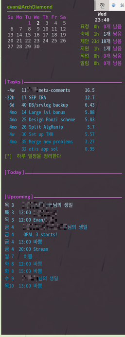

A couple of my students have asked me what my task management system is.

I have been reluctant to post about this for a while, for two reasons.
The first is I really like [xkcd 874](https://xkcd.com/874):

But the second reason is more damning:
my task management system doesn't actually work for me.

## … Wait, it doesn't work?

Well… okay, maybe a bit of an exaggeration.
What it does is prevent me from _forgetting_ about tasks.[^forget]
That part actually works fine:
my to-do list is generally pretty complete,
and I'm rarely blindsided by having something slip my mind.
I don't feel like I need to keep track of my work in my head.

[^forget]:
    Well, you could argue the point of a to-do app is
    so the human user can forget about tasks
    (the app remembers them for you).
    Depends on how you use the word "forget".

But it doesn't help me actually _do_ any tasks, or even prioritize them.
For example, I _know_ I'm supposed to study
my [Anki flashcards](https://en.wikipedia.org/wiki/Anki) every day,
because if you ever miss a day the next day is extra painful.
So I tell myself, just do it first thing in the morning and get it over with.

But like, I dunno, I have no self-discipline at all.

Like, sometimes I get an idea for how to make the view
on the OTIS-WEB testsolving interface less clunky.
And as soon as an idea enters my head, no amount of
"but you said you would study your flashcards first thing every morning!!!"
has ever been able to stop me from
[diving into a pull request](https://github.com/vEnhance/otis-web/pull/566).

Or sometimes `evan.sty` breaks due to a
[change in LaTeXe 2026](https://github.com/muzimuzhi/thmtools/issues/75)
and I need to switch from `thmtools` to `keytheorems`.
And then my entire day will disappear
because I can't stop myself from sinking my teeth into
[not only fixing that bug but cleaning up years of cruft while I'm at it][gitdiff].

[gitdiff]: https://github.com/vEnhance/dotfiles/compare/2cfa1e60805ed5894b46bf7e93bacbd5cd27edc5..258c670ab91375f4798570348b3bf7b206023b36

Or sometimes I just wake up, and I'm like, "nope", and I go back to sleep.
(Which I can do because I don't have normal working hours.)

… So yeah. I always know what I'm _supposed_ to do.
I just choose not to do it. 🎉

## The system

Okay, but since people asked, here's the tracking system anyway.
In theory, I think the best thing is to have only one source of information.
But I've never managed to compress to that point;
right now I have three sources:[^email]

1. **[Taskwarrior](https://taskwarrior.org)**: general system.
   Includes some recurring tasks like weekly database backup.[^backup]
   Hooked directly into [i3 via keyboard bindings][rofi],
   so I can instantly add or complete tasks.
   Handles scheduled and wait dates (so I can hide a task until it's relevant).
2. **Google Calendar** for appointments or meetings
   which really need to happen at a fixed time. Also birthdays.
3. A [daily checklist](https://github.com/vEnhance/dotfiles/blob/main/py-scripts/pyjo.py)
   for things I'd like to do every day,
   like processing OTIS problem sets and petitions, or shaving[^shave], or flashcards.
   (In theory Taskwarrior supports daily recurring tasks,
   but recurrence never felt intuitive;
   for things that happen every single day, checklists feel better.)

[^email]:
    Actually, there's really a fourth source: email inbox.
    It effectively functions as a to-do list which others can write to.
[^backup]:
    Maybe I should get around to automating this,
    but I'm still worried someday the backup script will fail and I won't notice.
[^shave]:
    I actually forget about this if it's not tracked.

But actually the backend isn't the important part.
For me, the MVP is actually [conky](https://w.wiki/U9AW).
I have it configured to draw an auto-updating sidebar that pulls all three
sources of information above and keeps it visible on the screen.
It looks something like this:

This has been pretty useful for me because it means the information
of what I need to get done is _always_ visible on-screen.
I don't need to take any action to have that information.

I've been thinking about adding another section for
"long-term projects in the back of your head to work on someday".
I might experiment with that and see how it goes.

[rofi]: https://github.com/vEnhance/dotfiles/blob/main/sh-scripts/tw-rofi.sh
